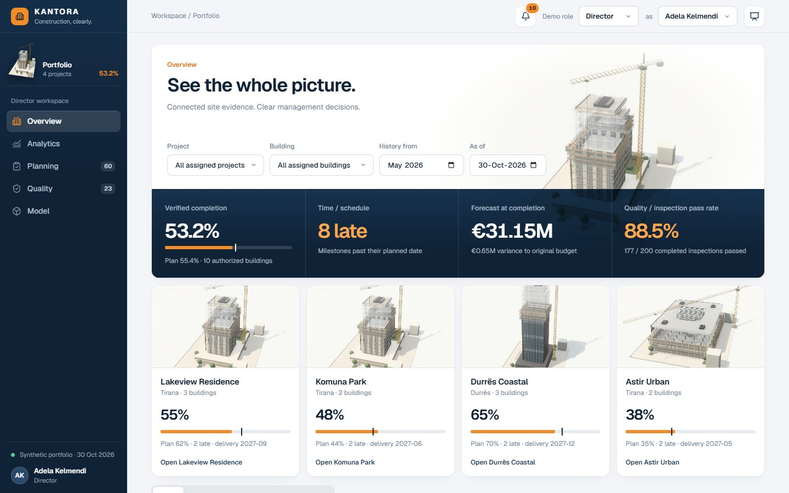
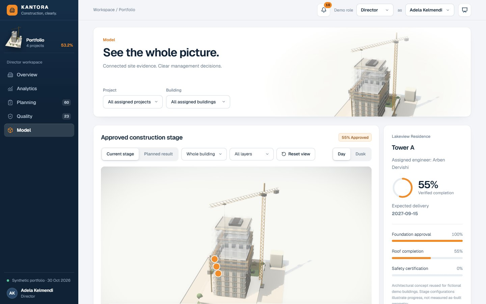
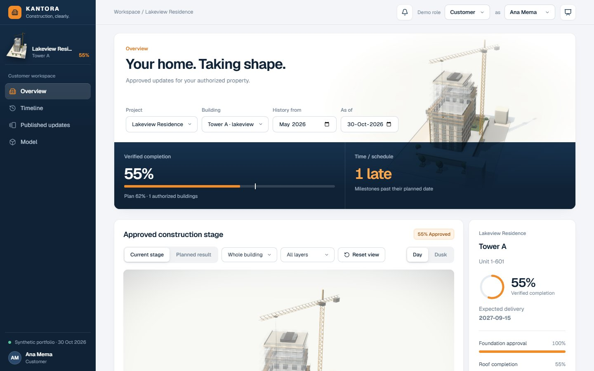
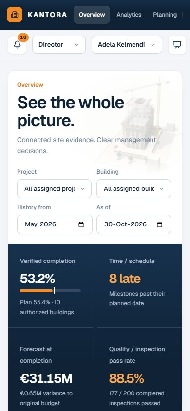

# KANTORA Next.js interactive demo



Independent frontend-only demonstration. The original `../gener2` platform is not modified or required at runtime.

## Run

Use Node 20.9+ and npm:

```powershell
npm ci
npm run dev
# Production
npm run build
npm run start -- --port 3000
```

Open http://localhost:3000/engineer. All eight roles have direct routes; switch roles from the header during a presentation.

## Live demonstration (five minutes)

1. Engineer → Capture → **Use synthetic site photograph**, or select a local photo. Enter an internal work report and propose 65% completion. Submit.
2. Manager → Reviews. Write a review note and approve. Internal progress changes; customer progress stays at 45%.
3. Director → Overview. Portfolio completion is now 52% (rounded mean of 65, 30 and 60). Cost figures come from labeled synthetic project fixtures; quality comes from inspections.
4. Manager → Reviews. Enter a public summary and publish.
5. Customer → Overview. Published progress is now 65%; Published updates shows only the public summary and approved image. Reload to verify persistence.
6. Engineer → Capture → choose three overlapping photographs and simulate processing. A real local GLB appears, explicitly labeled as a prebuilt concept, not reconstructed geometry.
7. Engineer → Tasks → submit completion. Manager → Tasks → validate it. Engineer → Quality → record an inspection; the quality indicator responds.
8. Reset demo data in the footer to start again.

## Screenshots

| Interactive 3D model                 | Customer view                              | Phone                                  |
| ------------------------------------ | ------------------------------------------ | -------------------------------------- |
|  |  |  |

## 3D

Three local architectural GLBs are reused from the original platform. Orbit/zoom, floor highlights, element selection, structure visibility, approved evidence pins, planned/current modes and dated approved overlays are interactive. The floor overlay is illustrative: a reported project percentage does not establish measured floor completion. Evidence pin positions are illustrative. History applies approved report values to the same conceptual model, not an as-built scan.

### Model pipeline

| Command                   | What it does                                                                                                                                                                                  |
| ------------------------- | --------------------------------------------------------------------------------------------------------------------------------------------------------------------------------------------- |
| `npm run models:optimize` | Upgrades the GLBs in `public/models` (physically based glass and metals, welded geometry, meshopt compression, about 10× smaller). Names are preserved because floor progress relies on them. |
| `npm run renders`         | With `npm run dev` running, renders the stills in `public/renders`: day and dusk views of each model plus a transparent cutout.                                                               |

The viewer uses image-based lighting, soft shadows, ambient occlusion, SMAA and an adaptive pixel ratio. It switches between day and dusk and shows scaffolding, a crane and site details around buildings under construction.

## Data and scope

All construction figures, schedules, property A-601, photos, assignments and finances are synthetic. Names reference Gener 2 portfolio projects; the geometry is not an official design or measured replica. See `public/models/README.md` for upstream provenance (its generator paths refer to the original repository).

Zustand persists records under `kantora-next-demo-v1` in localStorage. Local photographs are resized to JPEG; the demo limits retained reports to twelve. Reset erases only this demo's records. Role guards and filtering demonstrate workflows; **localStorage is not a security boundary**. Do not enter confidential information. No login service, API business routes, database, storage service, external AI or COLMAP execution is present.

## Verification

```powershell
npm run lint
npm run typecheck
npm run build
# Keep the production server running on port 3000 in another terminal
npm test
# or against another server: $env:BASE_URL = "http://localhost:3070"; npm test
```

See `docs/MIGRATION.md` for exact feature scope and `docs/ACCEPTANCE.md` for executed results. Browser tests save desktop/mobile screenshots in `docs/` and an HTML report in `playwright-report/`.

Browser tests currently use installed Google Chrome (Playwright channel chrome).
